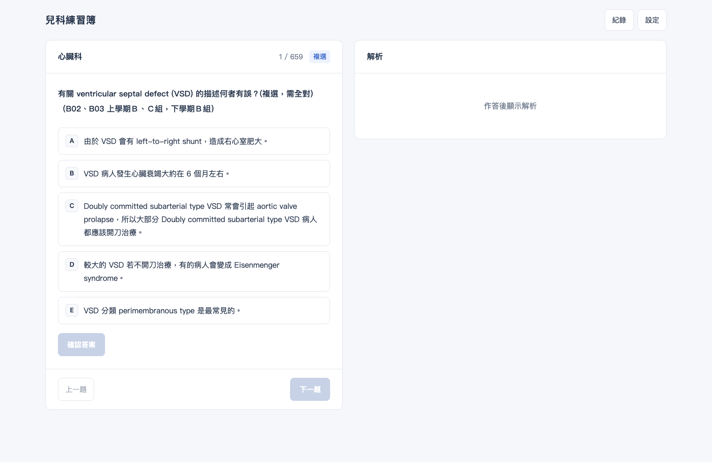
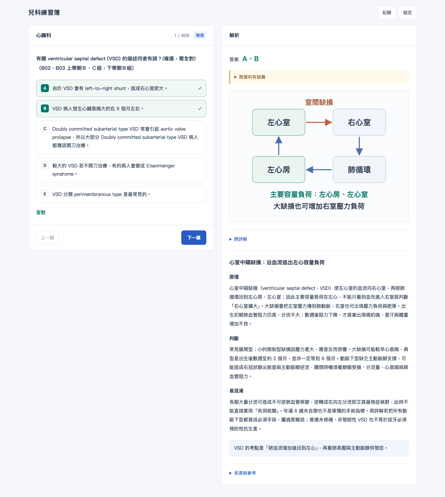
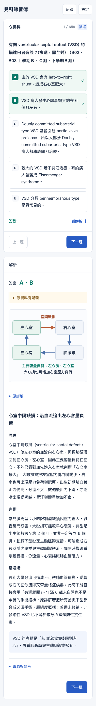

# 兒科練習簿

網站待確認公開後啟用。 [程式碼](https://github.com/Sanfufu20/pediatrics-quiz)

依原題順序，一題一題完成兒科考古。作答後查看原詳解、觀念補充與參考來源。

## 開啟

直接以瀏覽器開啟 `index.html`。CSS、JavaScript、題庫與圖片都在同一個檔案中，不需安裝套件、啟動伺服器或連網。參考資料的外部連結需連網開啟。

## 使用

1. 單選題按下答案，即顯示解析；複選題選好後按「確認答案」。
2. 不論答對或答錯，皆可閱讀解析，再按「下一題」；適用的解析先顯示示意圖，原詳解可展開對照。
3. 原書的問答、配對、缺選項或答案疑義題，採「查看解析，完成本題」自評，不納入正確率。
4. 進度儲存在目前瀏覽器，可重新開啟後接續；「紀錄」可回看已完成題目，不會重複計分。
5. 手機版提供「看解析」與解析末尾的「下一題」。

快捷鍵：數字 1–9 選對應選項；Enter 確認複選／完成自評／前往下一題。按鈕或連結取得焦點時，保留瀏覽器原有鍵盤操作。

## 題庫

來源為 B09 兒科考古題目本與上下冊詳解。全書 243 個內容頁（實體第 4–246 頁）共擷取 978 個題目區塊；合併 319 次重複出現，保留 659 題，其中 600 題可自動計分、59 題為自評題。

去重比較題幹、選項與共用情境，僅忽略空白與全半形差異。不同文字、選項順序或情境會保留；圖表題無法證明圖像完全相同時也保留。原題號與頁碼仍可在各題對照，同題不同版本的原詳解可展開閱讀。

解析包含 134 個延伸教學主題，659 題均已對應至少一個主題。全檔內嵌 321 張原題／詳解裁切圖，不依賴另外的圖片檔。

歷年答案與現行醫學觀念分開呈現。正確率依原書可明確判讀的答案計算；書內答案矛盾、誤貼解析等情況另有註記。補充教學附正式來源，仍不能視為逐題所有醫學敘述皆已完成專家審定。

## 介面

依使用回饋移除側欄、標語、英文副標與重複提示，主畫面保留題目、選項、解析及翻題。題號只顯示一次，來源、參考資料與疑義說明可展開閱讀。完整教學內容、題庫與進度儲存格式保留。另加入 7 張內嵌 SVG 示意圖，涵蓋 53 題的心臟分流、氧含量與氧輸送、21-羥化酶缺乏、蛋白尿及系譜圖符號。示意圖在作答後顯示，原題圖片保持原貌。

## 驗證

2026-10-18：使用本機無頭瀏覽器，在斷網模式直接開啟 HTML，實際從第一題走到最後一題；31 項操作檢查通過。包含答錯後顯示解析、複選確認、逐題順序、無重複計分、進度恢復、完成畫面、手機／平板版面、圖表載入及儲存不可用時的提示。測試過程無網頁程式錯誤、無自動外部網路請求。新增示意圖另通過 61 項檢查，確認離線解碼、手機版面、答錯後仍顯示，以及原詳解與參考資料可展開。

## GitHub Pages

可將 `index.html` 放在 GitHub repository 根目錄，於 Settings → Pages 選擇由 `main` 分支根目錄發布。GitHub Pages 提供網址，不需另外購買網域。

預計使用 `main` 分支根目錄發布，目前先保存於私有專案。下載 `index.html` 仍可離線使用；修改並推送到 `main` 後，GitHub Pages 會更新網站。

## 作業規格

- 對象：準備兒科考試，希望依序刷題並理解觀念的學生。
- 題序：依題本原順序，只合併能確認完全相同的重複題；不隨機抽題、不自動重複出題。
- 互動：單選即時作答，複選確認後顯示解析；完成本題才可前往下一題。
- 解析：保留原詳解與補充教學；原題圖片保留，適合的解析加入示意圖。
- 例外：原書問答、配對及答案矛盾等題型採自評，不強行計分。
- 閱讀：電腦左題右解、手機上下排列；移除不必要小字，來源資料可展開。
- 進度：保存在目前瀏覽器，可回看已完成題目，不重複計分。
- 交付：CSS、JavaScript、題庫與圖片皆內嵌在單一 `index.html`。

## 與 AI 修改的過程

先提出依序刷題、作答後看完整解析的需求，再確認整本收錄與去除完全重複題。製作時修正原題本重複題號、承上題缺情境、原答案矛盾等問題。依實際回饋移除側欄及重複小字，再加入心臟分流、氧氣輸送等示意圖。原考古答案與現行觀念分開呈現，沒有將程式測試成績視為個人成績。

## 介面截圖

